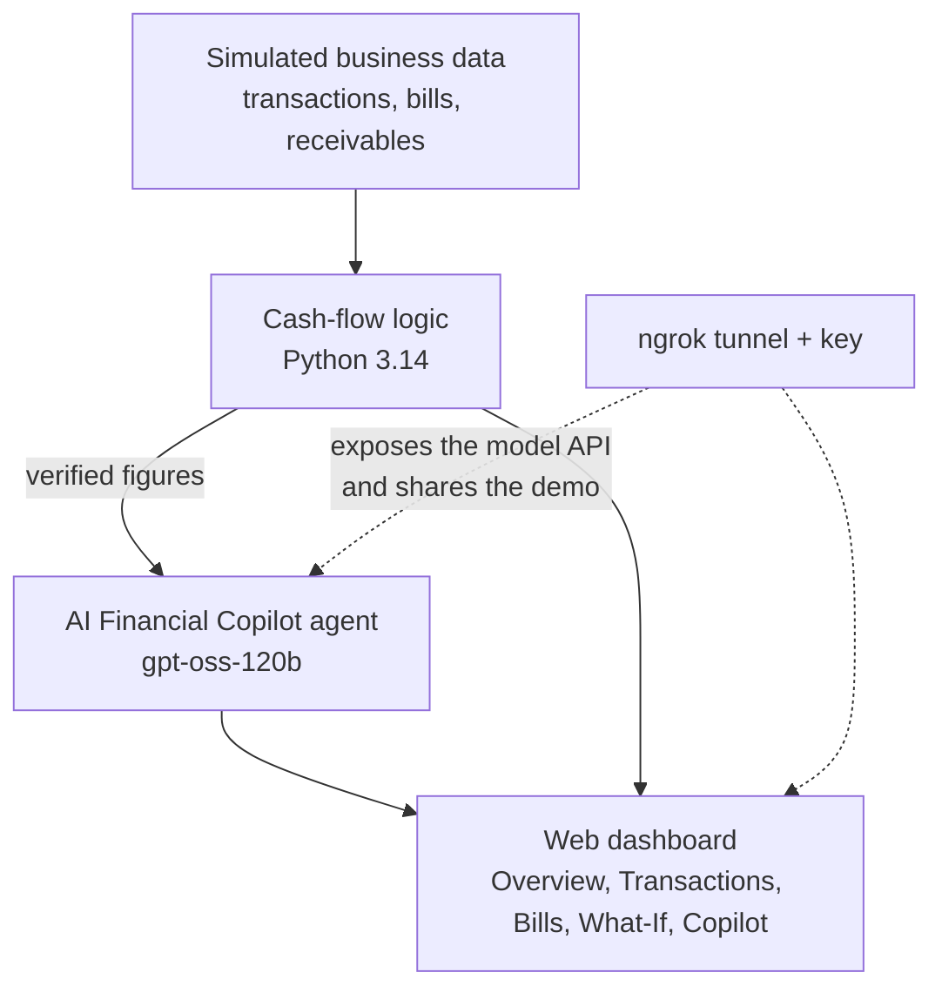

<div align="center">

# 📊 LedgerLens AI

### See your cash flow. Test your decisions. Plan with confidence.

An AI financial copilot that helps small businesses understand their cash position and safely test a purchase or a new hire **before** spending a single rupee.


-10a37f)


**Hacktoberfest Islamabad 2026 · Open AI Build Challenge**
Domain: **05 – Business & Productivity**

</div>

> ⚠️ **Demo mode:** all financial data in this project is simulated (fictional business *Northstar Office Supplies*, amounts in PKR). No real bank account is connected.

---

## 📑 Table of Contents

1. [Problem](#-problem)
2. [Solution](#-solution)
3. [AI Component](#-ai-component)
4. [Architecture](#-architecture)
5. [Tech Stack](#-tech-stack)
6. [Setup](#-setup)
7. [Demo](#-demo)
8. [Team](#-team)
9. [License](#-license)
10. [Acknowledgements](#-acknowledgements)

---

## 🧩 Problem

Small business owners often track money in notebooks, chat messages or scattered spreadsheets. That makes simple but critical questions hard to answer:

- *How much cash will I really have after next week's payroll and rent?*
- *Can I afford to hire someone at PKR 30,000 per month?*
- *What happens to my balance if a customer pays late?*

Wrong answers lead to cash shortfalls, late supplier payments and decisions made on gut feeling.

## 💡 Solution

**LedgerLens AI** turns a business's transactions, bills and receivables into a clear day-by-day cash-flow projection. The owner can then ask an AI copilot, in plain language, about their current position or about a planned decision.

> **Design rule: the app calculates, the AI explains.**
> Every figure (balances, projections, what-if results) is computed by the app's own Python logic. The language model only explains those verified figures, so it cannot invent financial numbers.

### Features

| Module | What it does |
|---|---|
| **Overview** | Current cash, net cash flow for the reporting period, lowest projected balance and balance at the end of the horizon. |
| **Transactions** | Completed income and expenses that make up the current cash balance. |
| **Bills & Receivables** | Unpaid bills and expected customer payments with due dates and overdue flags. The upcoming window can be set to 7, 30 or 60 days. |
| **What-If Simulator** | Test a one-time purchase, a recurring cost such as a new salary, or a delayed payment, and instantly see the new low point and end balance. |
| **AI Financial Copilot** | Chat assistant that explains the current position or a specific scenario in a fixed format: Result, Reason, Risks, Assumptions, Bottom line. |

### Example

> **You:** Can I hire a new employee with 30k salary per month?
>
> **Copilot:** The lowest projected balance drops from **PKR 71,000 to about PKR 41,000** (26 Oct), and the balance at the end of the horizon drops from **PKR 86,000 to about PKR 56,000**. Because the salary repeats every month, your cash cushion gets thinner unless receivables arrive on time.

## 🤖 AI Component

| Item | Details |
|---|---|
| **Model** | `openai/gpt-oss-120b`, an **open-weight** large language model released under the Apache-2.0 license |
| **Access** | The model is reached through an API endpoint exposed with **ngrok**, authenticated with an **ngrok key** |
| **AI agent** | A financial copilot agent receives the figures calculated by the app (current cash, obligations, receivables, daily cash movements, what-if results) and turns them into a clear explanation with risks and assumptions. It also answers follow-up questions in the chat. |
| **Guardrails** | The agent may only use figures provided by the app. Overdue receivables are excluded from projections and every assumption is stated openly. |

### Why AI is important here

Without the open-weight model, this would be an ordinary dashboard. The AI agent lets a non-finance business owner **ask a decision question in plain English and get a reasoned, risk-aware answer based on their own numbers**. Removing it removes the copilot, the scenario discussion and every explanation, which is the core purpose of the product.

## 🏗️ Architecture



**In short:** data goes into the cash-flow logic, the app calculates all numbers, the agent explains them in simple language, and ngrok makes the model endpoint and the live demo reachable over a public HTTPS URL.

## 🛠️ Tech Stack

| Layer | Technology |
|---|---|
| Language | Python **3.14** |
| AI model | `openai/gpt-oss-120b` (open-weight) |
| AI agent | Prompt-driven financial copilot agent |
| API access and sharing | **ngrok** (public HTTPS tunnel, authenticated with an ngrok key) |
| Interface | Interactive web dashboard with tabs, controls and chat input |
| Data | Simulated PKR dataset for a fictional business |

## 🚀 Setup

### Prerequisites

- Python **3.14**
- An **ngrok** account and its key (auth token)

### 1. Create a virtual environment

```bash
python3.14 -m venv .venv
source .venv/bin/activate        # Windows: .venv\Scripts\activate
```

### 2. Install dependencies

```bash
pip install -r requirements.txt
```

### 3. Add your ngrok key

Create a `.env` file in the project folder. Never upload this file publicly.

```env
NGROK_API_KEY=your_ngrok_key_here
```

### 4. Run the app

```bash
python app.py
```

### 5. Share it publicly with ngrok

```bash
ngrok config add-authtoken <YOUR_NGROK_KEY>
ngrok http 8501
```

ngrok prints a public `https://...ngrok-free.app` link that anyone can open from any device.

> 🔐 **No secrets are stored in this repository.** Keys are loaded from environment variables only.

## 🎬 Demo

1. Open the **Overview** tab and read the current position: PKR 200,000 cash, lowest projected balance PKR 71,000 on 26 Oct.
2. Open **AI Financial Copilot** and click *Explain my current cash-flow position.*
3. Ask: *Can I hire a new employee with 30k salary per month?*
4. Open the **What-If Simulator** to test other purchases or delayed payments and compare the results.

<!-- Add screenshots here, for example:  -->

## 👥 Team

| Member | Role and contributions |
|---|---|
| **Merab Butt** | AI agent and integration: copilot agent design, prompt and guardrails, model API access through ngrok. |
| **Ayesha Hassan** | Cash-flow logic: current cash, net flow, day-by-day projection, what-if simulator and simulated data. |
| **Fatima Zahra** | Interface and testing: dashboard tabs, result presentation, demo flow, scenario and edge-case testing. |

All three members took part in ideation, testing, documentation and the final demo.

## 📄 License

Released under the **MIT License**. See the [LICENSE](LICENSE) file.

## 🙏 Acknowledgements

- [OpenAI gpt-oss-120b](https://huggingface.co/openai/gpt-oss-120b): open-weight model (Apache-2.0)
- [ngrok](https://ngrok.com): secure tunneling
- Python 3.14 and the open-source libraries listed in `requirements.txt`
- **Hacktoberfest Islamabad 2026**, powered by MLH and organized by CNCF Islamabad

---

<div align="center">

*Built in Islamabad for Hacktoberfest 2026.*

</div>
